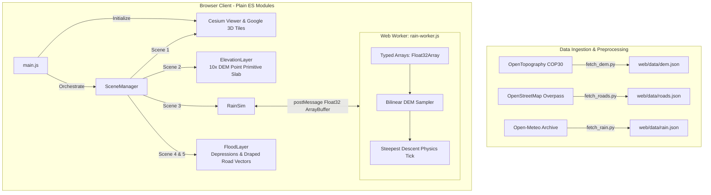

# Neer Vazhi (நீர் வழி) — OMR Rainwater Pooling Visualiser

[](LICENSE)
[](https://www.python.org/)
[](https://cesium.com/platform/cesiumjs/)
[](https://portal.opentopography.org/)
[](#disclaimer)

> **Disclaimer:** This software is an interactive educational and narrative visualisation, **not** a certified hydraulic or hydrological engineering flood model. It does not account for subterranean storm drainage networks, soil saturation rates, tidal ingress, or pumping stations.

An interactive 3D browser demonstration depicting how monsoonal rainwater runs downhill and pools along the critical **Thoraipakkam–Perungudi stretch of Old Mahabalipuram Road (OMR)** and the adjoining **Pallikaranai Marshland** in Chennai, India.

---

## Why This Exists

The IT corridor along OMR (SH-49A) and the adjacent Pallikaranai marsh basin represent one of Chennai's most flood-vulnerable urban zones. Urban development, elevated road embankments, and natural topography combine to create severe waterlogging depressions during Northeast Monsoon downpours (such as the Nov 2021 rains and Cyclone Michaung in 2023). 

Neer Vazhi ("Water Path" in Tamil) bridges the gap between raw geospatial data and public comprehension by providing a five-stage narrative visualization that explains *why* water collects where it does:
1. Grounding viewers in familiar photorealistic 3D city context.
2. Exaggerating true topographic relief to expose natural basins.
3. Simulating physical rainfall descent across elevation gradients.
4. Revealing low-lying sink ponds.
5. Projecting inundation depths and affected transit corridors onto the 3D cityscape.

---

## Key Features

- **Photorealistic 3D City Context:** Integrated with Google Photorealistic 3D Tiles via CesiumJS for recognizable local urban geometry without requiring heavy desktop GIS suites.
- **Topographic Slab View (10× Exaggeration):** Copernicus COP30 30-meter DEM rendered with elevation-based gradient ramps (teal for marsh depressions down to −2.9 m up to yellow for natural ridges at ~26 m).
- **Steepest-Descent Rain Particle Physics:** Particle simulation running 3,000+ dynamic raindrops that drop onto the terrain and roll along downhill elevation gradients using bilinear interpolation.
- **Off-Thread Physics via Web Worker:** Physics integration loops run inside a dedicated Web Worker (`rain-worker.js`) using high-performance typed arrays (`Float32Array`, `Uint8Array`) to keep Cesium rendering smooth at 60 FPS.
- **Depression Identification & Road Inundation Overlay:** Identifies topographic sinks (Pallikaranai depression, Perungudi lowlands) and dynamically colors 8,700+ OpenStreetMap road segments according to local depth thresholds.
- **Reproducible Python Data Pipeline:** Automated scripts to fetch real digital elevation models from OpenTopography, historical storm precipitation from Open-Meteo, and vector infrastructure from OpenStreetMap.

---

## Demo

<!-- TODO: Add recording GIF / screenshot of 5-scene workflow -->


### The 5 Visual Scenes

| Scene | Name | Description |
|:---:|:---|:---|
| **1** | **Google Photorealistic 3D Map** | Baseline bird's-eye view of the study bounding box centred on Thoraipakkam and Perungudi. |
| **2** | **Elevation Slab (10×)** | Google tiles yield to an extruded DEM point matrix colored teal (low marsh) to yellow (ridge). |
| **3** | **Rainfall & Downhill Runoff** | Rain drops spawn at 80 m altitude, accelerate under gravity, strike terrain, and roll downhill like marbles. |
| **4** | **Depression Pooling** | Water bodies coalesce in low-lying retention pockets, with depth expanding over time. |
| **5** | **Draped Flood on 3D City** | Return of the photorealistic 3D city tiles, with water bodies and flooded road polylines draped on the terrain. |

---

## Quick Start

### Prerequisites

- **Python 3.10+** (tested on Python 3.12)
- Modern WebGL2-capable browser (Chrome, Firefox, Edge, or Safari)
- Valid API keys:
  - **Google Maps Photorealistic 3D Tiles API Key** ([Google Cloud Console](https://console.cloud.google.com/))
  - **OpenTopography API Key** ([OpenTopography Portal](https://portal.opentopography.org/))

### 1. Clone & Setup Python Environment

```bash
git clone https://github.com/your-username/Neer-Vazhi.git
cd Neer-Vazhi

# Create and activate virtual environment
python -m venv .venv

# On Linux/macOS:
source .venv/bin/activate
# On Windows (PowerShell):
.venv\Scripts\Activate.ps1

# Install dependencies
pip install -r requirements.txt python-dotenv scipy
```

### 2. Configure Environment Keys

Create a `.env` file in the project root:

```env
OPENTOPO_KEY=your_opentopography_key_here
GOOGLE_MAPS_KEY=your_google_maps_3d_tiles_key_here
```

Generate the browser-safe client config:

```bash
python scripts/write_config.py
```

### 3. Fetch Data

Pre-generated data files are bundled in `web/data/`. To re-fetch or customize the study region:

```bash
# 1. Download digital elevation model (COP30)
python scripts/fetch_dem.py

# 2. Fetch OpenStreetMap road & waterway ways
python scripts/fetch_roads.py

# 3. Fetch precipitation archive (November 2021 storm event)
python scripts/fetch_rain.py
```

### 4. Run Web Application

Serve the `web/` directory using Python's static HTTP server:

```bash
python -m http.server 8765 --directory web
```

Navigate to: **[http://localhost:8765](http://localhost:8765)**

---

## Usage & Controls

- **Scene Stepper (Bottom Bar):** Click **◀** and **▶** to manually step through scenes 1 to 5.
- **Auto-Play:** Click **▶️** to trigger an automated looping 7-second progression.
- **Keyboard Shortcuts:**
  - `→` (Right Arrow): Advance to next scene
  - `←` (Left Arrow): Return to previous scene
  - `Space`: Toggle play / pause
- **Cesium 3D Camera:** Left-click + drag to pan, Right-click + drag (or scroll wheel) to zoom, Middle-click + drag to tilt and rotate.

---

## Configuration

Core bounding box parameters, camera coordinates, and simulation constants are governed by `config/area.json`:

| Key | Type | Example | Description |
|:---|:---:|:---|:---|
| `bbox.west` | Float | `80.195` | Western boundary (WGS84 Longitude) |
| `bbox.south` | Float | `12.900` | Southern boundary (WGS84 Latitude) |
| `bbox.east` | Float | `80.260` | Eastern boundary (WGS84 Longitude) |
| `bbox.north` | Float | `12.990` | Northern boundary (WGS84 Latitude) |
| `cesium_camera.height` | Integer | `8000` | Initial viewport altitude in meters |
| `cesium_camera.pitch` | Integer | `-35` | Camera viewing pitch angle (degrees) |
| `dem.exaggeration` | Integer | `10` | Vertical scale multiplier for Scene 2 slab |
| `simulation.drop_count`| Integer | `3000` | Maximum simultaneous rain particle entities |

### Environment Variables (.env)

| Variable | Required? | Description |
|:---|:---:|:---|
| `OPENTOPO_KEY` | Yes (for fetch) | OpenTopography Global DEM API authentication token |
| `GOOGLE_MAPS_KEY` | Yes (for 3D tiles) | Google Cloud key with Photorealistic 3D Tiles API enabled |

---

## Project Structure

```
Neer-Vazhi/
├── .env                          # API credentials (git-ignored)
├── .gitignore                    # Excludes secrets, raw DEMs, venv
├── CLAUDE.md                     # Agent conventions and technical specification
├── README.md                     # Repository documentation
├── requirements.txt              # Python runtime dependencies
│
├── config/
│   └── area.json                 # Study bounds, camera settings, simulation parameters
│
├── scripts/
│   ├── write_config.py           # Syncs .env keys to web/js/config.js and syncs area.json
│   ├── fetch_dem.py              # Downloads COP30 GeoTIFF from OpenTopography API
│   ├── fetch_roads.py            # Queries OSM Overpass API for road & waterway networks
│   └── fetch_rain.py             # Fetches historical hourly rainfall from Open-Meteo
│
└── web/                          # Static web application root
    ├── index.html                # Main application interface and Cesium container
    ├── css/
    │   └── style.css             # Glassmorphism dark UI theme and controls
    ├── data/                     # Compact client data files consumed by the browser
    │   ├── area.json             # Runtime study box definition
    │   ├── dem.json              # 4,800-cell elevation grid (EGM2008 orthometric)
    │   ├── rain.json             # 72-hour precipitation time series
    │   └── roads.json            # 8,700+ vector road linestrings
    └── js/
        ├── config.js             # Client-side Google key export (git-ignored)
        ├── main.js               # Application bootstrap and Cesium initialization
        ├── scene-manager.js      # 5-scene state controller and camera tweens
        ├── elevation-layer.js    # Scene 2: 10× exaggerated DEM point cloud slab
        ├── rain-sim.js           # Scene 3: Particle orchestration & Worker bridge
        ├── flood-layer.js        # Scenes 4-5: Depression pooling and draped road overlay
        ├── ui.js                 # Stepper navigation, telemetry stats, and legend
        └── workers/
            └── rain-worker.js    # Dedicated Web Worker: typed-array gradient descent
```

---

## Architecture Overview



---

## Technical Specifications & Units

- **Coordinate System:** WGS84 Geodetic coordinates (longitude, latitude in decimal degrees).
- **Elevation Datum:** Copernicus COP30 heights are referenced to the **EGM2008 geoid** (orthometric height in meters). *Note:* For artistic purposes, the geoid undulation over Chennai (~−96 m relative to WGS84 ellipsoid) is treated as a uniform offset and not subtracted, ensuring elevation values align cleanly with exaggerated 3D visual geometry.
- **Rainfall Units:** Depth in millimeters ($mm$), precipitation volume modeled in incremental time steps ($dt$).
- **No Bundler / No Framework:** Pure vanilla ECMAScript modules (`import`/`export`), standard DOM APIs, CSS Custom Properties, and CDN-pinned CesiumJS (`1.117`).

---

## Known Limitations

- **Heuristic Depression Detection:** Depression pooling is computed via local topological minima on a 30m grid rather than full 2D hydrodynamic Saint-Venant equations.
- **Underground Drainage:** Stormwater drains, culverts, and canal pumping stations along OMR are not represented in the DEM.
- **Tidal Boundary:** Buckingham Canal and Kovalam Creek tidal backwater dynamics are not simulated.
- **Google 3D Tiles Depths:** Draped polygons in Scene 5 use Cesium's `ClassificationType.CESIUM_3D_TILE`, which requires WebGL2 and hardware depth buffers.

---

## License & Acknowledgements

- **License:** Distributed under the [MIT License](LICENSE).
- **Data Providers:**
  - Copernicus DEM GLO-30 provided via [OpenTopography](https://opentopography.org/) (European Space Agency / Airbus).
  - Road network and infrastructure data &copy; [OpenStreetMap contributors](https://www.openstreetmap.org/copyright) (ODbL).
  - Historical weather records courtesy of [Open-Meteo Historical Weather API](https://open-meteo.com/).
  - 3D Urban Photorealistic Tiles powered by [Google Maps Platform](https://developers.google.com/maps/documentation/tile/3d-tiles).
