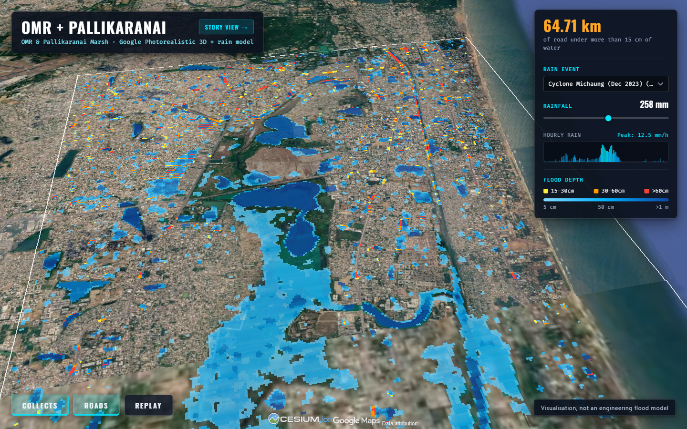
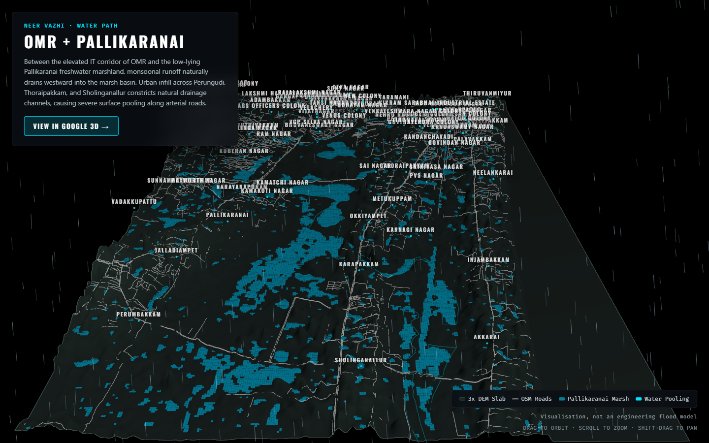
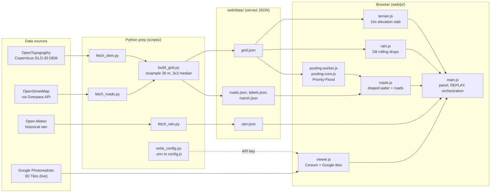

# Neer Vazhi (நீர் வழி) — OMR Floods

**A browser visualisation of where monsoon rain pools along Chennai's Old Mahabalipuram Road (OMR) and the Pallikaranai marsh — drawn on Google Photorealistic 3D Tiles.**


<!-- TODO: replace the screenshot above with a short GIF of REPLAY (see "Recording the hero GIF" at the bottom). -->

> [!IMPORTANT]
> **This is a visualisation, not an engineering flood model.** It shows where a simple terrain model says water *would* collect. It has no drains, no pumps, no time dimension and no validation against real flood records. Do not use it for planning, insurance, evacuation or safety decisions. See [Limitations](#limitations-read-this).

---

## What it shows

Press **REPLAY** on the main page and a 7-step guided tour plays, with a caption for each step:

| # | Caption on screen | What happens |
|:-:|---|---|
| 1 | *Old Mahabalipuram Road and Pallikaranai Marsh, Chennai.* | Slow orbit over the real 3D city. |
| 2 | *This box is our study area: OMR corridor and Pallikaranai basin.* | A white outline draws itself around the study area (about 12.89–12.99 °N, 80.19–80.27 °E). |
| 3 | *Underneath is the land's real shape, mapped from space by radar.* | A flat elevation slab, built from a radar DEM, fades in. |
| 4 | *Stretch it 10x and the dips appear.* | The slab's vertical exaggeration animates to 10×. |
| 5 | *Let it rain. Every drop runs downhill.* | 3,000 drops fall and roll downhill until they reach a hollow. |
| 6 | *Low ground fills first — monsoonal runoff pools into the marsh basin.* | Water rises in every hollow on the slab. |
| 7 | *Back on the real map, these arterial roads go under.* | The slab fades out; the water and roads are draped on the 3D city, with roads coloured by depth. |

Beside the tour, the right-hand panel is live:

- **Rain event** — four presets (see the [table](#rain-presets)) and a **rainfall slider** (0–500 mm). Changing either re-runs the water model and redraws the map.
- **Hourly rain chart** with a playhead that moves during REPLAY.
- **Live stat** — kilometres of road under more than 15 cm of water.
- **Road colours** — yellow 15–30 cm, orange 30–60 cm, red over 60 cm. Water is shaded from pale blue (shallow) to deep blue (over about 1 m).
- **Buttons** — `COLLECTS` (water layer), `ROADS` (flooded-road layer), `REPLAY`.
- **Keys** — `Esc` skips to the end of the tour, `T` toggles the terrain slab, `W` water, `P` roads.

There is a second, **keyless** page, `story.html`, built with Three.js. It needs no Google key: it shows the same terrain, roads, marsh outline, locality labels and modelled water pooling (fixed at 150 mm of rain) as a stylised 3D model you can orbit.



---

## How it works



`story.html` is separate: it loads `grid.json`, `roads.json`, `labels.json` and `marsh.json` itself and runs the same `pooling.worker.js` with Three.js instead of Cesium.

### The water model, in plain words

1. **A height grid.** The radar elevation data is resampled to a regular grid of 30 m cells (289 × 369 cells for the study area) and lightly smoothed with a 3×3 median filter to take the edge off rooftops and trees.
2. **Drops roll downhill (D8).** Each falling drop lands on a cell, then repeatedly moves to whichever of its 8 neighbours is steepest downhill, like a marble. When there is no lower neighbour it has reached a hollow and stops. This is the animation you see in step 5.
3. **Priority-Flood finds the low spots.** The Priority-Flood algorithm (Barnes, Lehman & Mulla, 2014) works out, for every cell, the level that water would reach before it spilled over the rim of its hollow. Where that level is above the ground, the cell sits inside a hollow, and the difference is the depth when the hollow is full.
4. **Rain is converted to volume and routed.** Every cell yields `rainfall (mm) × runoff coefficient (0.8) × cell area` of water. That water follows the same D8 downhill path into a hollow. Each hollow fills from its lowest point upward, and once it is full the surplus spills on to the next hollow downstream. Cells beyond the edge of the grid count as the outlet (the sea, effectively).
5. **Draw it.** Cells holding more than 5 cm of water are drawn on the slab, and more than 8 cm in the draped view. Road segments are coloured by the depth under their midpoint, and the kilometre stat adds up every segment deeper than 15 cm.

The heavy part (steps 3–4) runs in a Web Worker so the page stays responsive when you move the slider.

### Limitations (read this)

- **A visualisation, not an engineering flood model.** It is not calibrated. The VALIDATE button compares it with 167 known waterlogging spots from the Greater Chennai Corporation (see `docs/scores.md`); the hit rates there are low (32-44%).
- **No drains, pumps, culverts, canals or tanks.** Chennai's real drainage network is not in the data, so the model cannot show water leaving through it.
- **Static pooling.** The water depth is computed once from the *total* rain of the selected event. It does not evolve hour by hour. The hourly rain series only draws the chart and its playhead.
- **One runoff coefficient (0.8) everywhere.** No soil, land-cover, infiltration or evaporation.
- **The 30 m DEM is a surface model.** Copernicus GLO-30 measures the top of whatever is there: rooftops, tree canopy and so on, not bare ground. The median filter softens this but does not remove it, so dense built-up areas can show fake hollows or ridges.
- **Coarse rain data.** The rain presets come from a reanalysis model (roughly 11–25 km cells), which averages over a large area and tends to under-record short, intense downpours. Presets are labelled accordingly in the app.
- **Two different height sources.** The flood layers are computed from the DEM, while the buildings you see underneath come from Google's separate 3D data. They are not guaranteed to line up exactly.

### Rain presets

These come from `web/data/rain.json`:

| Preset | Total | Hourly steps | Source |
|---|---:|---:|---|
| Cyclone Michaung (Dec 2023) | 257.7 mm | 120 | Open-Meteo archive (reanalysis) |
| Chennai floods (Nov–Dec 2015) | 142.1 mm | 96 | Open-Meteo archive (reanalysis) |
| Synthetic heavy day | 200.0 mm | 24 | Generated: 200 mm in 24 h, triangular peak at hour 10 |
| Cyclone Michaung, Perungudi gauge reference | 440.0 mm | 36 | Generated: 440 mm in 36 h, a reference total for a rain gauge in the area |

---

## Quick start

### Prerequisites

| Need | Why | Notes |
|---|---|---|
| **Python 3.10+** | Config and data scripts | Developed on 3.12. |
| **Node.js** | Dev server and unit test | Optional: `python scripts/serve.py` works without it. Developed on Node 22. |
| **A WebGL2 browser** | The 3D view | Developed and tested in a Chromium-based browser. Turn on hardware acceleration. |
| **Google Maps API key** | Photorealistic 3D Tiles | Needs a Google Cloud project with **billing enabled** and **Map Tiles API** switched on. Without it the main page falls back to Esri satellite imagery and `story.html` still works. |
| **OpenTopography API key** | Only to re-download the DEM | Free key from OpenTopography. Not needed to run the app: the prepared data is already in `web/data/`. |

### 1. Install

```bash
# from the project folder
python -m venv .venv

# activate it
#   Windows PowerShell:  .venv\Scripts\Activate.ps1
#   macOS / Linux:       source .venv/bin/activate

pip install -r requirements.txt
```

### 2. Add your keys

Create a file named `.env` in the project root (it is git-ignored — never commit it):

```ini
GOOGLE_MAPS_KEY=your_google_maps_api_key_here
OPENTOPO_KEY=your_opentopography_api_key_here
```

Then write the browser config (this creates `web/js/config.js`, also git-ignored, and copies `config/area.json` to `web/data/area.json`):

```bash
python scripts/write_config.py
```

Because the key ends up in a browser file, **restrict it** in Google Cloud: under *Credentials → your key → Application restrictions → Websites* add `http://localhost:8765/*`, and under *API restrictions* allow only **Map Tiles API**.

### 3. Run

```bash
npm start
# or, without Node:
python scripts/serve.py
```

Open:

- Main page (Google 3D, controls, REPLAY): <http://localhost:8765/google3d.html>
- Keyless Three.js page: <http://localhost:8765/story.html>

`npm start` uses the next free port (8766, 8767 …) if 8765 is busy and prints the address it chose, so use that address. Set `PORT` to choose your own (PowerShell: `$env:PORT=9000; npm start`). `serve.py` takes the port as an argument: `python scripts/serve.py 9000`.

**First load is slow.** Google streams the 3D tiles on demand, so give it 20–40 seconds on first load before judging the 3D view.

> Use `npm start` or `scripts/serve.py` rather than plain `python -m http.server`. The standard Python server sends no cache headers, so browsers may keep running an old copy of the JavaScript after you edit it.

### 4. (Optional) Rebuild the data

The repository already contains the prepared files in `web/data/`. To re-download everything or change the study area:

```bash
python scripts/fetch_dem.py       # Copernicus GLO-30 DEM    -> data/raw/dem_COP30.tif  (needs OPENTOPO_KEY)
python scripts/fetch_roads.py     # OSM roads, labels, marsh -> data/raw/*.geojson
python scripts/fetch_rain.py      # rain presets             -> web/data/rain.json
python scripts/build_grid.py      # grid, roads, labels, marsh -> web/data/*.json
python -I scripts/build_validation.py  # known flood points (data/validation/) -> web/data/validation.json
python -I scripts/build_validation_zones.py  # flood-zone polygons -> web/data/validation_zones.json
node scripts/score_presets.mjs    # score every rain preset -> docs/scores.md
```

Run them in that order. `fetch_dem.py --demtype SRTMGL1_E` fetches a different DEM; `build_grid.py --dem <path>` points to a different file.

### 5. (Optional) Run the unit test

```bash
npm test
```

This runs `web/test/pooling.test.mjs`, which checks the heap, Priority-Flood and the depth calculation. `web/test/test-pooling.html`, `test-rain.html` and `test-roads.html` are interactive test pages you open from the running server (for example `http://localhost:8765/test/test-pooling.html`).

---

## Data sources and attribution

| Data | Provider | Licence / terms | Attribution to show |
|---|---|---|---|
| 3D city imagery (live) | **Google Photorealistic 3D Tiles** (Map Tiles API) | [Map Tiles API policies](https://developers.google.com/maps/documentation/tile/policies) and the Google Maps Platform terms | Attribution comes back with each tile and must be shown in a line, usually along the bottom. Use the **Google Maps logo** (or the words "Google Maps" where space is tight), unmodified and not covered by any other logo. The viewer shows it automatically. Google's rules also say you may not pre-fetch, store, bulk-download or derive content from the tiles, and that they are for map visualisation only. |
| Terrain heights (DEM) | **Copernicus GLO-30**, distributed by **OpenTopography** | Copernicus licence (free to the general public; see the [dataset page](https://portal.opentopography.org/datasetMetadata?otCollectionID=OT.032021.4326.1)) | © DLR e.V. 2010–2014 and © Airbus Defence and Space GmbH 2014–2018, provided under COPERNICUS by the European Union and ESA; all rights reserved. Cite: *European Space Agency (2024). Copernicus Global Digital Elevation Model. Distributed by OpenTopography.* <https://doi.org/10.5069/G9028PQB> |
| Roads, localities, marsh outline | **OpenStreetMap**, fetched via the Overpass API | [Open Database Licence (ODbL)](https://www.openstreetmap.org/copyright) | "© OpenStreetMap contributors" (or "OpenStreetMap" linking to <https://www.openstreetmap.org/copyright>); see the [attribution guidelines](https://osmfoundation.org/wiki/Licence/Attribution_Guidelines). `roads.json`, `labels.json` and `marsh.json` contain data derived from OSM, so the ODbL attribution and share-alike terms apply to them. |
| Historical rain | **Open-Meteo** historical weather API (ERA5 / ERA5-Land reanalysis) | [CC BY 4.0](https://open-meteo.com/en/terms). The free API is for non-commercial use. | Credit Open-Meteo and cite: *Zippenfenig, P. (2023). Open-Meteo.com Weather API.* <https://doi.org/10.5281/ZENODO.7970649>. Open-Meteo's published acknowledgement for the Copernicus data: "Generated using Copernicus Climate Change Service information 2022." See the [historical API page](https://open-meteo.com/en/docs/historical-weather-api). |
| Fallback map imagery | **Esri World Imagery** | Esri terms | Shown only when Google tiles are unavailable. The credit text comes from the service and is displayed by Cesium. |

**Libraries and fonts:** [CesiumJS](https://github.com/CesiumGS/cesium) 1.117 (Apache-2.0), [Three.js](https://threejs.org/) r160 (MIT), and the Oswald and Fira Code fonts from Google Fonts (SIL Open Font Licence). All are loaded from CDNs, pinned to those versions.

**Be clear in your own UI which part is Google's.** The water, roads and statistics are this project's model and are *not* Google data. Google's policy asks hybrid scenes to say plainly which part comes from Google Maps.

---

## Project structure

```
Neer-Vazhi/
├── config/
│   └── area.json             # study area + simulation settings (source copy)
├── data/
│   └── validation/           # (empty) reserved for ground-truth flood points
├── docs/
│   ├── google3d.png          # README screenshots
│   └── story.png
├── scripts/
│   ├── write_config.py       # .env -> web/js/config.js, and copies area.json into web/data/
│   ├── make_config.py        # same config.js step, without the area.json copy
│   ├── fetch_dem.py          # OpenTopography COP30 -> data/raw/dem_COP30.tif
│   ├── fetch_roads.py        # Overpass -> data/raw/roads.geojson, labels.geojson
│   ├── build_validation.py   # data/validation/*.kml -> web/data/validation.json (points inside the box)
│   ├── build_validation_zones.py # GCC flood-zone polygons -> 30 m raster for scoring
│   ├── score_presets.mjs     # runs the model per rain preset, writes docs/scores.md
│   ├── fetch_rain.py         # Open-Meteo + synthetic presets -> web/data/rain.json
│   ├── build_grid.py         # DEM + OSM -> web/data/{grid,roads,labels,marsh}.json
│   ├── validate_gcc.py       # placeholder for validation against flood points
│   └── serve.py              # no-cache dev server (stdlib only)
├── web/
│   ├── google3d.html         # MAIN PAGE: Cesium + Google 3D Tiles, controls, REPLAY
│   ├── story.html            # keyless Three.js version (no Google key needed)
│   ├── index.html            # older entry page, not linked from the current pages
│   ├── css/style.css         # styles for google3d.html
│   ├── data/                 # prepared data the browser loads
│   │   ├── area.json         #   copy of config/area.json
│   │   ├── grid.json         #   30 m height grid (289 x 369)
│   │   ├── roads.json        #   OSM road lines
│   │   ├── labels.json       #   locality labels
│   │   ├── marsh.json        #   Pallikaranai marsh outline
│   │   ├── rain.json         #   rain presets
│   │   └── dem.json          #   legacy, only read by the unused elevation-layer.js
│   ├── js/
│   │   ├── boot-guard.js     # shows load/runtime errors on screen
│   │   ├── config.js         # GOOGLE_MAPS_KEY (generated, git-ignored)
│   │   ├── main.js           # panel, REPLAY timeline, orchestration
│   │   ├── viewer.js         # Cesium viewer, Google tiles, satellite fallback
│   │   ├── terrain.js        # elevation slab + 10x exaggeration
│   │   ├── rain.js           # falling/rolling drops (D8)
│   │   ├── pooling.js        # slab water + worker interface
│   │   ├── pooling.worker.js # runs the water model off the main thread
│   │   ├── pooling-core.js   # Priority-Flood and the depth calculation (pure functions)
│   │   ├── road-burn.js      # lowers terrain along OSM roads (area.json roadBurnM) so water follows streets
│   │   ├── validation-core.js # hit / wet-area / depth-error scoring (pure functions)
│   │   ├── validation.js     # VALIDATE button: rings on the map and the score card
│   │   ├── roads.js          # draped water, marsh and depth-coloured roads
│   │   ├── scene-manager.js, ui.js, elevation-layer.js,
│   │   │   flood-layer.js, rain-sim.js, workers/rain-worker.js
│   │   │                     # legacy 5-scene stepper: not loaded by either page
│   │   └── pooling-plan.md, rain-plan.md    # design notes
│   └── test/                 # pooling.test.mjs + three test pages
├── server.js                 # Node dev server (no-cache, port fallback)
├── package.json              # npm scripts
├── requirements.txt          # Python dependencies
└── CLAUDE.md                 # conventions for AI coding agents
```

Not shown: `.env` (your keys), `.venv/`, `node_modules/` and `data/raw/` (downloaded source files) — all are git-ignored.

---

## Configuration

`config/area.json` is read by the Python scripts. The browser reads the copy at `web/data/area.json`, so **after editing it run `python scripts/write_config.py`** to refresh that copy.

| Field | Default | Used by | What it does |
|---|---:|---|---|
| `south` | `12.890` | all scripts, browser | Southern edge of the study area (WGS84 latitude). |
| `west` | `80.190` | all scripts, browser | Western edge (WGS84 longitude). |
| `north` | `12.990` | all scripts, browser | Northern edge. |
| `east` | `80.270` | all scripts, browser | Eastern edge. |
| `cellSizeM` | `30` | `build_grid.py` | Grid cell size in metres. Re-run `build_grid.py` to apply it. |
| `drops` | `3000` | `main.js` | Number of simultaneous rain drops in REPLAY. Lower it on slower machines. |
| `runoffCoeff` | `0.8` | `main.js` | Fraction of rain that becomes runoff (0–1). |
| `exaggeration` | `10` | *not wired up yet* | Reserved. The 10× slab exaggeration is currently a constant in `web/js/terrain.js` (`TARGET_EXAG`). |

The four bounds can also be given nested as `"bbox": { "south": …, "west": …, "north": …, "east": … }`; the scripts accept both layouts.

Other values live in code: the rainfall slider range (0–500 mm) in `google3d.html`, and the fall height, speed and roll speed of the drops at the top of `web/js/rain.js`.

---

## Costs and limits

- **Google Photorealistic 3D Tiles** are a paid Google Maps Platform service with a free monthly allowance. Each page view streams many tile requests. See Google's current [Map Tiles API usage and billing](https://developers.google.com/maps/documentation/tile/usage-and-billing) page for what is charged, and set a **budget alert** (Billing → Budgets & alerts) so a loop or a shared link can't surprise you. Google does not allow caching or pre-fetching of the tiles.
- **OpenTopography** needs a free API key and applies its own rate limits; see [opentopography.org/developers](https://opentopography.org/developers). You only hit it when you re-run `fetch_dem.py`.
- **Overpass API** is a shared public service. `fetch_roads.py` makes a few requests and waits 30 seconds and retries once on HTTP 429, 502 or 504; please be gentle. See the [usage policy](https://wiki.openstreetmap.org/wiki/Overpass_API).
- **Open-Meteo** free access is for non-commercial use within its published daily limits; see the [terms](https://open-meteo.com/en/terms).

---

## Troubleshooting

**The page shows a red box.** The page reports its own load errors. Read it: it names the file or library that failed, and it also appears if loading takes more than 25 seconds.

**Black or empty 3D view.**
- Wait 20–40 seconds for the first tiles.
- Check that hardware acceleration is on in your browser, and that WebGL works (visit <https://get.webgl.org>).
- Check for a red box (above). If it mentions `cdn.jsdelivr.net`, a network, VPN or ad/content blocker is stopping the Cesium or Three.js download.
- Press `F12` → Console for details.

**Stuck on "Initializing 3D water model…" (`story.html`).** The loader turns into an error message if a file fails or the water worker fails. If you see the loader and nothing else, hard-refresh with `Ctrl+Shift+R` and use `npm start` or `python scripts/serve.py` (see the cache note above).

**403 errors, and a small notice about "3D buildings unavailable".**
- The Google key is rejected. The most common cause is that **billing is not enabled** on the project, or **Map Tiles API is not enabled**.
- Next check: the key's *API restrictions* include Map Tiles API, and its *website restrictions* include the exact address and port you opened (for example `http://localhost:8765/*`). If the server moved to port 8766, add that too.
- Changes can take a few minutes to apply.
- Meanwhile the main page keeps working on Esri satellite imagery.

**Blank page when double-clicking an `.html` file, or CORS errors.** The pages use JavaScript modules and `fetch()`, which browsers block for `file://` addresses. Always open them through the local server (`http://localhost:…`).

**`Failed to load resource … ERR_CONNECTION_CLOSED` for `.glb` tile files.** An occasional dropped connection from Google's tile servers. Cesium retries on its own and the view recovers; it is not a bug in the app.

**`Address already in use` / a different port.** Something else holds 8765. `npm start` moves to the next port automatically; for `serve.py` pass another port. Remember to allow that port in the key's website restrictions.

**`ModuleNotFoundError: dotenv` or `scipy`.** Install the requirements: `pip install -r requirements.txt` inside your virtual environment.

**`fetch_dem.py` says the key is missing or bad (HTTP 401).** Check `OPENTOPO_KEY` in `.env`.

**Roads don't show on an unusual graphics setup.** The draped road layer needs the browser's depth-texture support; it is skipped with no error if the browser lacks it.

---

## Roadmap

- [ ] **Validation layer.** Compare modelled pooling against recorded flood points (for example Greater Chennai Corporation inundation points placed in `data/validation/`) and report a hit rate. `scripts/validate_gcc.py` is the starting stub.
- [ ] **Time-stepping water.** Use the hourly rain series so water rises, spills and drains over the event instead of one static result.
- [ ] **Drains and outlets.** Add the stormwater network, culverts, canals and river mouths as sinks.
- [ ] **Better ground.** Reduce rooftop and tree effects in the DEM, and vary the runoff coefficient by land cover.
- [ ] **Tidy-up.** Wire `exaggeration` into the code, and remove the legacy stepper modules and `index.html`.

---

## Credits and licence

- Water-routing methods: *Barnes, R., Lehman, C., Mulla, D. (2014), "Priority-flood: An optimal depression-filling and watershed-labeling algorithm for digital elevation models", Computers & Geosciences 62, 117–127.* <https://doi.org/10.1016/j.cageo.2013.04.024>, and the classic D8 steepest-descent flow-direction method.
- Data: Google, ESA / Copernicus (DLR, Airbus) via OpenTopography, OpenStreetMap contributors, Open-Meteo and the Copernicus Climate Change Service — see [Data sources and attribution](#data-sources-and-attribution).
- Built with [CesiumJS](https://github.com/CesiumGS/cesium) and [Three.js](https://threejs.org/).

**Licence:** MIT, as declared in `package.json`. (A separate `LICENSE` file has not been added yet.) The licence covers this project's code only. The data and services above keep their own terms.

---

## Recording the hero GIF

The top image is a still screenshot. To replace it with a GIF of REPLAY:

1. Start the app (`npm start`), open the main page and wait until the 3D tiles have loaded.
2. Record the browser window with a screen recorder such as ScreenToGif (Windows) or Kap (macOS). Click **REPLAY** and record about 45 seconds. For a smaller file, use a window of about 1280 × 720 and 12–15 frames per second.
3. Export as GIF (keep it under about 10 MB) and save it as `docs/replay.gif`.
4. In this file, change `docs/google3d.png` in the first image to `docs/replay.gif` and delete the `TODO` comment under it.
